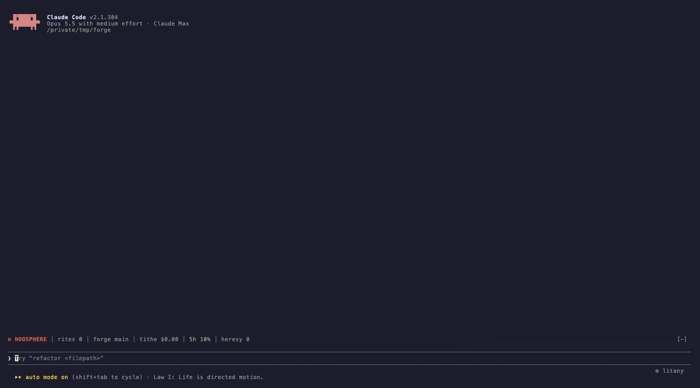

<div align="center">

# ⚙ litany

**Turn Claude Code into a Tech-Priest's cogitator.**

Machine-cult spinner phrases, a telemetry band and side panel, warn-only "heresy" rites, synthesized beeps and spoken lines. An unofficial Warhammer 40,000 fan mod, free forever.

[](https://github.com/shakespear-dev/litany/actions/workflows/ci.yml)
[](LICENSE)
[](https://claude.com/claude-code)




</div>

## Install

In Claude Code:

```
/plugin install litany --marketplace shakespear-dev/litany
```

From a shell: `claude plugin install litany --marketplace shakespear-dev/litany`. In the desktop app: **+** next to the prompt box → **Plugins** → **Add marketplace** `shakespear-dev/litany` → **Add plugin**.

Everything is on by default. Run `/litany` to see what's running.

## What you get

|               |                                                                                                                                                                                                                                             |
| ------------- | ------------------------------------------------------------------------------------------------------------------------------------------------------------------------------------------------------------------------------------------- |
| **Spinner**   | Phrases follow the active tool: *Anointing the cogitator* for Bash, *Sifting the Librarium data-stacks* for Read and Grep.                                                                                                                  |
| **Turn line** | *Rite concluded in 3s* instead of *Baked for 3s*.                                                                                                                                                                                           |
| **Band**      | The Noosphere line above the prompt: context, tool calls, branch, cost, 5-hour window, heresies.                                                                                                                                            |
| **Panel**     | The NOOSPHERE side panel: animated art in falling binharic, gauges, a braille pulse of tool calls per minute, a per-tool tally, a roster of running subagents and the latest tool calls. It docks by itself in terminals 144+ columns wide. |
| **Voice**     | A short `+++ … +++` opener and closer on chat replies. Never in code, commits, tool inputs or text you'll send to someone else.                                                                                                             |
| **Rites**     | Warns, never blocks, on `rm -rf`, force-push, `reset --hard`, `curl \| sh`, `DROP TABLE` and friends.                                                                                                                                       |
| **Sound**     | Seven synthesized clips: long turn done, heresy, tool failure, permission waiting, API error, subagent waiting, auto-compaction.                                                                                                            |
| **Vox**       | A short spoken line after each of those, from a formant speech synthesizer built into the mod. No recordings, no network.                                                                                                                   |

## Commands

```
/litany                        every switch and its state
/litany off | on               everything off or on for this session
/litany sound off              mute the beeps, keep the rest
/litany panel                  open or close the panel
/litany theme forge            mars · cogitator · forge · claude
/litany vox cogitator          default · mars · cogitator · forge · claude · off
/litany volume master 5        master, beeps or vox, 0–10
/litany say forge Hello.       speak any English text once
```

Session commands last until the session ends. For lasting settings, every part has its own row in `/config`.

## Themes and voices

| Theme            | Look                                                | Voice                                     |
| ---------------- | --------------------------------------------------- | ----------------------------------------- |
| `mars` (default) | red and bronze servo-skull                          | a tech-priest chanting through a vox-horn |
| `cogitator`      | green CRT cog                                       | the console's mechanical woman            |
| `forge`          | amber tech-priest at a console                      | the ancient, unstable engine              |
| `claude`         | your Claude Code colours, best on light backgrounds | the clean one                             |

## Requirements

- Claude Code with mods.
- **macOS:** nothing else.
- **Linux:** one of `pw-play`, `paplay`, `aplay` or `ffplay` for sound, plus `sh` and `base64`. With no player, or over SSH, it stays silent and everything else still works.

## Contributing

Issues and PRs are welcome, AI-assisted ones too, as long as you understand what you submit and keep the description short. See [CONTRIBUTING.md](CONTRIBUTING.md).

```sh
claude plugin validate .
claude plugin test .
claude --plugin-dir .          # try it in a real session
```

## A note to Games Workshop

Thank you. The Adeptus Mechanicus is one of the best ideas in science fiction, and this mod exists only because your writers and artists created it. I'm a fan who wanted my terminal to feel like a cogitator.

This is a fun project and nothing more. It is free, will never be sold, and will never carry ads, paid tiers or donation links. It ships no artwork, logos or audio of yours: the art is original ASCII, and the sounds and voices are synthesized from scratch.

If anything here crosses a line, please open an issue or email [contact-shakespear@a.bytes-mail.com](mailto:contact-shakespear@a.bytes-mail.com) and it will be changed or taken down right away. No takedown notice needed. Please don't kill it, and sorry for borrowing the vocabulary.

## Disclaimer

litany is completely unofficial and in no way endorsed by Games Workshop Limited. Warhammer, Warhammer 40,000, Adeptus Mechanicus, Omnissiah, Tech-Priest and all associated marks, names, characters, places and imagery are either ®, ™ and/or © Games Workshop Limited, variably registered around the world. They are used here without permission in a non-commercial fan work. No challenge to their status is intended.

Claude Code is a product of Anthropic. litany is not affiliated with or endorsed by Anthropic.

The software is provided as is, without warranty of any kind. See [LICENSE](LICENSE).

## Credits

The speech synthesizer is derived from [formant-tts](https://github.com/PrakharSaxena24/formant-tts) by Prakhar Saxena (MIT), with fixes.

## License

[MIT](LICENSE) for the code, the ASCII art and the sounds. The licence grants no rights in Games Workshop's intellectual property.
